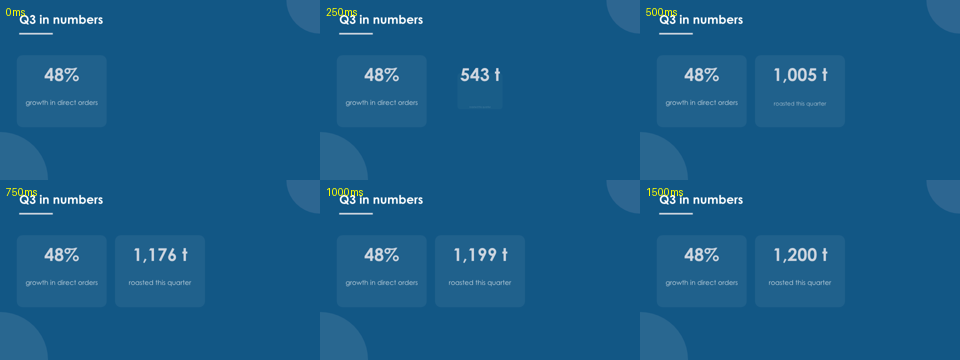
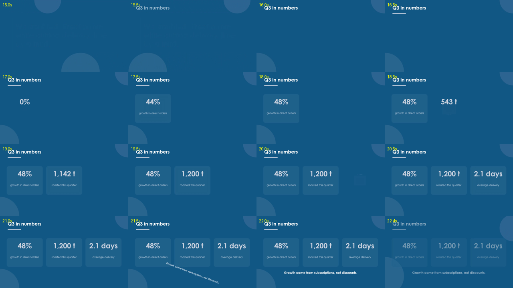
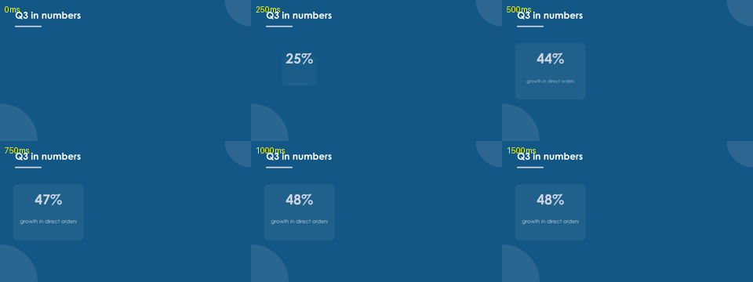
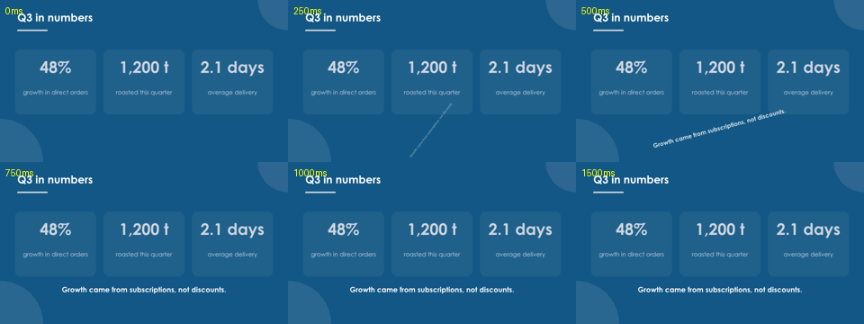
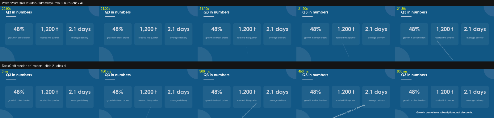

# T060 [pptx] — DeckCraft source study: in-slide animation frames

- **Agent / model:** OpenCode (DeepSeek V4.1 Flash Max), builder for the
  T058–T065 programme.
- **Date:** 2026-11-04. **Branch:** `work/T060-opencode-deckcraft-source`,
  base `ac5b45e` (the claim commit on top of `c3e1d27`).
- **Subject:** `storytold/deckcraft` @
  `23ac4f7efdbd1e538bd9a7869584d4adeb9039b0` (2026-11-03), workspace version
  0.15.0, MIT OR Apache-2.0. Cloned `--depth 1` into git-ignored
  `workspace/deckcraft-src`; no source is vendored here.
- **Brief:** `experiments/T057-20261104-claude-leader-review/REPORT.md`,
  section T060. **Claim:** `research/claims/T060-opencode-20261104.md`.

## Answer

**Yes — a real timing-tree player exists.** It is `deckcraft-anim`, a pure-Rust
crate: `Timeline` turns a slide's `animations` into click steps and gives every
shape an `AnimState` at `(step, t)`; `ShowState` adds click/arrow navigation;
`effects.rs` evaluates entrance, exit, emphasis and path effects. The desktop
show and the editor preview both use it.

**No — it is not exposed headlessly.** At HEAD the CLI has no animation command.
`render` draws the slide at rest; `render-transition` draws only slide
transitions; the GIF exporter says in its header that build animations are not
animated.

**The gap to `render-animation --slide N --click K --t ms` is small for
main-sequence frames.** `render_slide` already takes a per-shape state closure;
the GUI's `render_frame` is the proof. A 151-line prototype (7 files) adds the
command, and it renders the Forge `dynamic` deck. Upstream quality — tests,
triggers, media, placeholder geometry, preset table — is the larger job.

**The gap to trustworthy PowerPoint fidelity is bigger than the gap to the
command.** DeckCraft has 107 animation ids; the lab has 198 PowerPoint-authored
presets. 102/198 (51.5%) have a matching class+preset id, but at most 67/198
(33.8%) get an exact or file-path behaviour: 28 exact, 27 approximated, 8
identity-shifted, 39 path, 96 missing. On the Forge `dynamic` deck all 12
distinct keys resolve (94 effects exact, 18 identity-shifted, 6 custom paths),
so the player is usable for that deck. A probe deck found one hard timing bug:
behaviour-level `repeatCount` is dropped, so a 3.000 s PowerPoint pulse plays
for 1.000 s in DeckCraft.

## Frame

**Question.** Does `storytold/deckcraft` contain a timing-tree / slide-show
player; what is it written in and where; which subset of PowerPoint effects does
it play; what work exposes `render-animation --slide N --click K --t ms`; and
how do its frames compare with PowerPoint CreateVideo strips for the Forge
`dynamic` deck, specifically easing, auto-reverse, repeat, motion paths and the
198 `ppt:` presets?

**Hypotheses and falsifiers.**

| Hypothesis | Falsifier |
|---|---|
| H1. A pure timing-tree player exists in the source and the GUI show reuses it. | No code path from `slide.animations` to a per-shape render state. |
| H2. A headless frame is a composition of existing pieces, not a new renderer. | The show path needs GPU/egui state that the CPU renderer cannot accept. |
| H3. The player covers our deck's effects but not the whole 198-preset library. | Fewer than 50% of our presets map, or the `dynamic` deck uses a preset that does not map. |
| H4. Frames match PowerPoint for the `dynamic` deck's easing, auto-reverse, repeat and paths. | A visible direction/state mismatch, or a timing feature silently dropped. |

H1 and H2 were confirmed. H3 is confirmed in substance: 51.5% get any mapping,
but only 33.8% get an exact/path behaviour, so the "fewer than 50%" falsifier is
met for faithful playback and narrowly not met for mere id mapping. H4 is
confirmed for the dynamic deck's spot checks and for motion paths, but **falsified
for repeat** on the probe: the behaviour-level repeat is dropped. Auto-reverse is
read when it is on the effect `cTn`, or on every behaviour; a file that puts it
on only one of several behaviours loses it.

**Domain lens.** PresentationML timing (`p:timing`, `p:cTn`, `presetID`,
`presetClass`, `presetSubtype`, `nodeType`, `repeatCount`, `autoRev`, `accel`,
`decel`, `p:animMotion`), the lab's PowerPoint-harvested
`knowledge/powerpoint_presets.json`, PowerPoint 16.0's own
`Slide.TimeLine.MainSequence` parse and CreateVideo export, and the Forge
`coffee_office_dynamic.json` deck. There is no cross-domain import here; this is
a pptx-internal source study. DeckCraft is an external open-source tool, not a
second design domain.

## Frozen input

| Item | Value |
|---|---|
| Lab base | `ac5b45e` on `work/T060-opencode-deckcraft-source` (base of the programme claim; parent `c3e1d27`) |
| DeckCraft source | `github.com/storytold/deckcraft` @ `23ac4f7efdbd1e538bd9a7869584d4adeb9039b0`, 2026-11-03 20:39:57 −0500, workspace 0.15.0 |
| Licence | MIT OR Apache-2.0 (`LICENSE-MIT`, `LICENSE-APACHE`, `Cargo.toml`) |
| Clone | `git clone --depth 1` into `workspace/deckcraft-src`; git-ignored |
| Deck under test | Forge build of `examples/pptx/forge/coffee_office_dynamic.json`: 10 slides, 118 effects, 37 main steps, 636,542 bytes, SHA-256 `2d0d9798d31784416311a62b39c802f227623c6c174f3b361111452105f4d3b3` |
| Probe deck | 4 slides, one auto effect each, 32,900 bytes, SHA-256 `33b81dd442fbb550fedee8af6a48d6538eb22cb990100ebb20430d1b0131bffb` |
| PowerPoint | 16.0 build 17932, COM; `native_sequence.json` 80,790 bytes, SHA-256 `2514a0841f03142f6b9f333748faffc7701bbbde213b185ae5ad1205fad767c2` |
| CreateVideo | 77.58 s, 1280×720, 30 fps, 5,827,681 bytes; kept in `workspace/ppt_render/`, not committed |
| Environment | Windows 11; Rust/cargo 1.99.1; Python 3.13 with lxml, Pillow, matplotlib 3.10.6; ffmpeg 8.1.1 |
| Build | `deckcraft-cli` 0.15.0 from source at the commit above; cold build 7m 16s, incremental 6–9 s |

**Could not access / did not do.** No upstream account, push, issue or PR; no
DeckCraft GUI screenshot or desktop-show capture; CreateVideo exposes no click
timestamps, so the PowerPoint strips are aligned by scene inspection; no macOS,
Linux or wasm build; the local `deckcraft-cli` 0.13.1 was not used for frame
evidence. PowerPoint's COM dump gives per-effect durations but not click-group
durations. The lab preset table is assumed to be PowerPoint-authored (its
`source` field says `PowerPoint-authored via harvest_presets.ps1`); if that
table is wrong, the id-conflict findings invert.

## Method

1. **Source read.** Clone; `rg` for `Timeline`, `AnimState`, `ShapeState`,
   `RenderOpts.state`, `presetID`, `repeatCount`, `autoRev`, `accel`, `decel`,
   `animMotion`; `git grep render-animation HEAD` (no hits). Commands:
   `inputs/rg-commands.md`; module map: `inputs/source-tree.md`.
2. **Preset comparison.** `inputs/analyze_presets.py` parses the 107-entry
   `ANIMATIONS` static and joins it to the 198 lab presets by class + preset id
   (first match, the same rule as `maps::effect_for_preset`). Outputs:
   `inputs/preset-coverage.csv`, `inputs/preset-summary.json`,
   `inputs/table-conflicts.csv`.
3. **Forge deck.** `scripts/slide_forge.py build
   examples/pptx/forge/coffee_office_dynamic.json -o
   workspace/coffee_dynamic.pptx`; inventory from the XML:
   `inputs/inspect_dynamic_deck.py` → `inputs/dynamic-deck-inventory.{md,json}`.
4. **PowerPoint native parse + CreateVideo.** `scripts/powerpoint_render.ps1`
   (with a retry wrapper for a transient `RPC_E_CALL_REJECTED` on cold COM) →
   `inputs/powerpoint-native-sequence.json` and the MP4. Frames with ffmpeg.
5. **Prototype.** Patched the clone: `render::shape_state` (the GUI's mapping,
   moved into the render crate) plus `deckcraft-cli render-animation` and a help
   page. Patch: `artifacts/proto-render-animation.patch`. Build and tests:
   `cargo build -p deckcraft-cli`, `cargo test -p deckcraft-anim` (98 passed),
   `cargo test -p deckcraft-cli --test it` (20 passed).
6. **Step comparison.** `inputs/compare_steps.py` runs
   `render-animation --plan` for every slide and compares step counts and
   durations with PowerPoint's MainSequence grouped at each `on click` trigger.
   Output: `inputs/step-durations.csv`.
7. **Probe deck.** `inputs/make_probe.py` builds four auto-start effects:
   spin (auto-reverse/repeat requested), native pulse with `repeat=3`, fly with
   effect-level accel/decel, custom path with accel/decel. PowerPoint parse,
   CreateVideo, DeckCraft `animation.get`, and rendered frames at 30 fps
   equivalent. Path positions: `inputs/path-positions.csv`.

The full command log, including the exact `rg` and build commands, is in
`inputs/rg-commands.md`; environment and hashes are in
`artifacts/build-log.md`.

## Evidence

### 1. The player exists and is pure logic — rung 1

| Fact | Measured | Rung |
|---|---|---|
| Language / workspace | Pure Rust, Cargo workspace, edition 2024, `deckcraft-anim` is a workspace crate | 1 |
| Timing tree player | `crates/anim/src/timeline.rs`: `Timeline::with` builds click steps; `state_ordered` composes `AnimState`; `status` applies repeat/autoRev/rewind/after | 1 |
| Effect evaluation | `crates/anim/src/effects.rs`: `eval`, `entrance`, `emphasis`, `motion`; `easing.rs::ease`; `path.rs::MotionPath` | 1 |
| Show navigation | `crates/anim/src/show.rs`: `ShowState`, click steps, hidden slides, custom shows, timings, triggers in `interact.rs` | 1 |
| GUI reuse | `ui-egui/src/show/render.rs::render_frame` calls `state_for` + `render_slide` with `RenderOpts.state`; `canvas/preview.rs::shape_state` is the editor twin | 1 |
| Tests on the player | `cargo test -p deckcraft-anim`: 98 passed, 0 failed | 1 |
| Lab suite | `python -X utf8 -m unittest discover -s tests`: 461 tests, OK, 8 skipped | 1 |
| Layout gate | `python lab/tools/check_layout.py`: layout OK | 1 |

### 2. No headless animation command at HEAD — rung 1

| Fact | Measured | Rung |
|---|---|---|
| `render-animation` in source | `git grep -n "render-animation" HEAD` returns nothing | 1 |
| CLI surface | 11 subcommands: `info render render-transition convert run commands describe app mcp bench links` | 1 |
| `render` | Draws one slide at rest; no `state` closure | 1 |
| `render-transition` | Draws transition frames `t=0..1` between two slides; no in-slide timeline | 1 |
| GIF export | Header: "Transitions and build animations are not animated: a slide appears as it looks when its builds have finished" | 1 |
| Show frame path | Private to `ui-egui`, returns an egui `ColorImage`; not callable from the CLI | 1 |

The pieces are one composition away, not a new renderer: `RenderOpts.state:
Option<&dyn Fn(ShapeId) -> ShapeState>` already exists in `crates/render/src/opts.rs`.

### 3. Prototype: the command works — rung 2

Patch: 7 files, 151 insertions, 2 deletions (`artifacts/proto-render-animation.patch`).
It adds `render::shape_state` (25 lines), the CLI command (105 lines), a help
page, one dependency and the subcommand-list test.

```
deckcraft-cli render-animation FILE --slide N [--click K] [--t MS[,MS...]]
                                   [--plan] [--width PX] OUT.png
```

Semantics: `--slide N` is 0-based like `render`/`render-transition`; `--click K`
is the number of main steps already played (`0` = the slide as it appears,
`steps` = fully built); `--t` is milliseconds into step `K`. `--plan` prints
each step's kind, duration and effect count.

| Check | Result | Rung |
|---|---|---|
| Cold build | 7m 16s (first cargo run in this clone, network for git patches) | 1 |
| Incremental build | 6–9 s | 1 |
| `deckcraft-anim` tests | 98 passed | 1 |
| CLI integration tests | 20 passed, including "every subcommand answers help" | 1 |
| Frame output | 1280×720 PNG, 44–55 KB, from the real deck | 2 |
| `--plan` on KPI slide | 5 steps: 250, 800, 1001, 660, 600 ms | 2 |
| Edge checks | `--click` past the last step errors; `--t` negative/non-finite errors; multiple `--t` names include `-cK-tMS` | 2 |



*DeckCraft `render-animation --slide 2 --click 2` at 0, 250, 500, 750, 1000 and
1500 ms. The count-up runs 543 → 1,005 → 1,176 → 1,199 → 1,200 and the card
settles; this is the player's own model, not PowerPoint.*

### 4. Timing tree reconstruction against PowerPoint — rung 4 vs 1

PowerPoint's `Slide.TimeLine.MainSequence` and the deck XML were compared
effect by effect:

| Check | Result | Rung |
|---|---|---|
| Effects seen | 118 in both | 4 |
| Trigger type | 118/118 agree (`on click` / `with previous` / `after previous`) | 4 |
| Per-effect duration | 106/106 finite durations agree within 2 ms; 12 persistent opacity states are `indefinite` in PowerPoint and 0 ms in DeckCraft, both meaning "hold" | 4 |
| Main-step count | 37 in both; per slide 1,1,5,3,6,5,7,3,3,3 | 4 |
| Step durations | 29/37 exact; 2 pairs differ by −1 ms (rounding); 6 differ because the flat PowerPoint grouping cannot express after-previous chains, and DeckCraft's values are the sequential sums (700+700, 300+450 ×4, 700+6000) | 4 |

`--plan` for slide index 2 (KPI) vs PowerPoint:

| Step | DeckCraft | PowerPoint flat max | Note |
|---|---|---|---|
| 0 | 250 ms | 250 ms | auto wipe |
| 1 | 800 ms | 801 ms | 19 effects, counters to 800 ms |
| 2 | 1001 ms | 1002 ms | 25 effects, counters to 1000 ms |
| 3 | 660 ms | 660 ms | KPI 3 |
| 4 | 600 ms | 600 ms | takeaway |

The six longer DeckCraft values are not errors: e.g. slide index 4 step 2 is a
300 ms wipe plus a 450 ms expand after it, which the flat `max(delay+duration)`
model reports as 450 ms; DeckCraft reports 750 ms, the sum a real show takes.

### 5. Frames against PowerPoint CreateVideo — rung 2 vs 5

The `dynamic` deck's KPI slide was chosen because it combines the deck's hardest
features: an automatic wipe, three Faded Zoom cards, 40 count-up
appear/disappear frames and a Grow & Turn takeaway.



*PowerPoint CreateVideo, slide index 2 from 15.0 to 22.4 s. Count-ups show
0% → 44% → 48%, then 543 t → 1,142 t → 1,200 t, then 2.1 days, then the
takeaway grows in around 21.0–21.4 s.*




*DeckCraft click 1 (`25% → 47% → 48%`) and click 4 (takeaway). The intermediate
count values differ because the two engines sample different frames of the same
stack; the final states and the card scaling match.*

Grow & Turn is the one effect where a still frame looks broken in DeckCraft (a
diagonal streak). PowerPoint does the same thing: the takeaway is rotated and
scaled through the animation, then lands upright. Side by side, with the video's
click time fitted by eye:



*Top: PowerPoint at 20.9–21.3 s. Bottom: DeckCraft at 0–600 ms after click 4.
The diagonal mid-state is faithful; the strip is offset because CreateVideo does
not expose the click clock.*

**Motion path probe (quantitative).** A separate 4-slide probe moves a shape
0.25 slide widths right over 1000 ms with effect-level accel 0.2 / decel 0.6.
PowerPoint frames at 30 fps were aligned by fitting the animation start
(8.7 s + 0.36 s). The shape centre then differs by at most **0.0078 slide widths
(10 px at 1280, 0.78%)** across the path; endpoints are identical. This is the
strongest positive result for path support. See
`artifacts/compare-path-progress.png` and `inputs/path-positions.csv`.

### 6. Feature coverage

| Feature | DeckCraft model | Dynamic deck uses it? | Evidence | Gap |
|---|---|---|---|---|
| **Click steps** | `Timeline` groups `OnClick` / `WithPrevious` / `AfterPrevious`; `ShowState::steps` and `step_duration` | Yes, 37 steps | 37/37 counts; 29/37 durations exact, 6 explained | None found |
| **Easing** | `accel`/`decel`/`bounceEnd` read from the **effect** `cTn`; `ease()` implements PowerPoint's three-phase ramp, `smooth()` default for fly/float/rise/peek/paths | `wipe`/`fade` linear; custom path has 0.2/0.6 | Formula match; path probe 10 px; fly probe differs less than 50 px at 640 under a naïve start | PowerPoint-authored presets carry easing on **behaviour** `cTn` (21 of our 198); reader ignores it and substitutes smoothstep |
| **Auto-reverse** | Effect `cTn autoRev`, or every behaviour `cBhvr/p:cTn autoRev`; `status` doubles the period and reverses progress; `rewind` separate | No | Probe `pulse` returns `autoReverse: true`; source `status` | `behaviour_auto_reverses` requires **all** behaviours to carry `autoRev`; one behaviour without it drops the flag |
| **Repeat** | Effect `cTn repeatCount` / 1000, `indefinite` = `u32::MAX`; `status` loops when `until_next_click` | No | Probe `pulse` with behaviour `repeatCount="3000"`: DeckCraft `repeat: 1`, 1.000 s; PowerPoint 3.000 s | **Hard bug**: behaviour-level repeatCount is never folded; our native `pulse`/`teeter` and custom effects write it there |
| **Motion paths** | `p:animMotion/@path` parsed as slide-fraction `M/L/C/Q/H/V/Z/E`; arc-length parameterisation; global effect-level easing | 6 custom paths | 10 px max at 1280; endpoints exact | `ptsTypes` (per-segment easing), `rAng`, `origin`/`pathEditMode` ignored; minor for our paths |
| **198 `ppt:` presets** | 107 `ANIMATIONS`; `effect_for_preset` by class+id, fallback fade/pulse/customPath | 12 distinct keys, all resolve | 102/198 mapped (51.5%); 28 exact, 27 approximate, 8 id-shift, 39 path, 96 missing | At most 67/198 (33.8%) faithful; see below |
| **Compound effects** | One `Animation` per effect node, then effect-specific approximations (`grow` = scale+rotate+fade, `zoom` = scale+fade, `spinner` = rotate+scale+fade) | Faded Zoom 53, Grow & Turn 31 | Grow & Turn matches; Faded Zoom approximate | Extra behaviours beyond the chosen id are discarded; a custom compound loses its other limbs |
| **Triggers** | `interact.rs` models `TriggerPlay`/`StepStamp`; `render_frame` accepts them | No | Source only | `--click` covers the main sequence only; a `--trigger` design is needed for T049-style decks |
| **Media / sounds / transitions** | `ShowState` handles media cues; transitions are separate | No | Source only | Not part of the requested command |

**Preset coverage detail.**

| Class | Lab presets | DeckCraft entries | Mapped by id | Exact | Approx | Id-shift | Path | Missing |
|---|---|---|---|---|---|---|---|---|
| Entrance | 52 | 24 | 23 | 10 | 10 | 3 | — | 29 |
| Exit | 52 | 23 | 23 | 10 | 10 | 3 | — | 29 |
| Emphasis | 30 | 17 | 17 | 8 | 7 | 2 | — | 13 |
| Path | 64 | 40 | 39 | — | — | — | 39 | 25 |
| **Total** | **198** | **107** | **102 (51.5%)** | **28** | **27** | **8** | **39** | **96** |

`exact` means a dedicated evaluator branch that reproduces the mechanism;
`approximate` means visible but substituted (e.g. Blinds = opacity fade, Circle
= centre rectangle clip, Split = centre clip); `id-shift` means the id maps to a
different PowerPoint effect; `path` means motion runs from the file's own path
or the preset geometry; `missing` means the id is absent and the reader falls
back to `fade`/`fadeOut`/`pulse`/`customPath`.

**The 11 genuine table conflicts** (`inputs/table-conflicts.csv`) matter because
`effect_for_preset` matches by id, not by name. The clearest:

| Class:id | Lab table (PowerPoint) | DeckCraft | Consequence |
|---|---|---|---|
| Entrance/Exit 42 | Ascend / Ascend Out | Float / Float Out | T057's "Ascend loses its `ppt_x` anim" is explained: the reader calls it Float and the writer emits Float's behaviour. |
| Entrance/Exit 53 | Faded Zoom | Zoom | DeckCraft's scale+fade is close to Faded Zoom, but the real Zoom (id 23) is absent → a PowerPoint Zoom falls back to a fade. |
| Entrance/Exit 45 | Faded Swivel | Swivel | Same inversion; the real Swivel (id 19) is absent. |
| Emphasis 26 | Flash Bulb | Pulse | A white flash becomes a grow pulse. |
| Emphasis 27 | Flicker | Color Pulse | A flicker becomes a colour pulse. |
| Emphasis 19 | Color Blend | Object Color | A colour cycle becomes a single tint. |

**The Forge `dynamic` deck is inside the supported subset.** Its 12 distinct
keys are `entr:1` (appear), `entr:10` (fade), `entr:22` (wipe), `entr:31`
(grow-and-turn), `entr:37` (rise-up), `entr:42` (ascend → Float), `entr:53`
(faded-zoom → Zoom), `entr:55` (expand), `exit:1` (disappear), `emph:6`
(grow-shrink), `emph:9` (transparency), `path:0` (custom path). 94 effects are
exact, 18 are id-shifted, 6 are custom paths. No effect falls back to a generic
fade, so the deck is a fair smoke test, not a coverage test.

### 7. What work exposes `render-animation`?

The prototype is the minimal answer. For an upstream-quality patch:

| Step | Work | Size / risk |
|---|---|---|
| A. Public state mapping | Move `shape_state` (or an `AnimState -> ShapeState` converter) into `deckcraft-render` or `deckcraft-anim`; make the GUI use it | 25 lines; low risk; removes a duplicated mapping |
| B. CLI command | `render-animation` parse/validate/render/help; `--plan`; multi-frame names; errors | ~105 lines; low risk; follows `render-transition` |
| C. Tests | No-animation slide; `K > steps`; `K = steps`; negative/NaN `t`; multiple `t`; help page; golden frame for a 4-slide probe | ~100 lines; medium: a golden frame can drift with fonts/renderer |
| D. Preset table | Correct 42/53/45/30/23/19 and emphasis 26/27/19; add a harvested-table test | 1–2 days including PowerPoint harvest; **changes round trip**, needs review |
| E. Behaviour-level repeat | Fold `repeatCount` from the behaviour `cTn` when the effect `cTn` has none; test with the pulse probe | ~20 lines + test; medium: must not double-count when both levels repeat |
| F. Behaviour-level easing | Decide whether `accel`/`decel`/`bounceEnd` come from effect or behaviour; test against PowerPoint frames | 1–3 days; needs a frame oracle |
| G. Compound behaviours | Preserve extra `anim`/`animEffect` limbs or add dedicated evaluators (Faded Zoom, Faded Swivel, Flash Bulb, Flicker) | weeks; not required for the `dynamic` deck |
| H. Triggers / media | `--trigger` playheads, media cues, hidden shapes, transition + animation composition | 3–5 days; separate from this command |

**Estimate.** A reviewable main-sequence `render-animation` (A+B+C) is **1–2
days** for a maintainer who knows the crate; the prototype took this session
because the cold build and the Forge/PowerPoint comparison dominated. Without
D–F the frames are DeckCraft-faithful, not PowerPoint-faithful: label them
`DeckCraft render`, never `PowerPoint`.

**Patch plan, not a patch.** Do not push. The proposal to the owner is:
`render-animation` (A+B+C) as one PR, with D/E as separate issues and F/G as
research; do **not** bundle a preset-table rewrite with a new command, because
the table change alters round-trip output (T057 already measured that).

## Negative results and limits

1. **No headless command at HEAD.** The player is real, but `render-animation`
   does not exist; `git grep` is empty and the GIF exporter explicitly excludes
   build animations. The falsifier "no player exists in the CLI build" is
   literally true for the command, false for the library.
2. **Preset coverage is below half for faithful playback.** 102/198 map
   (51.5%), but at most 67/198 (33.8%) are exact or file-path; 96 are missing,
   27 approximated, 8 identity-shifted. The 50% falsifier is met under the
   faithful definition and narrowly not met under id mapping. Both numbers are
   in `inputs/preset-summary.json`.
3. **Behaviour-level repeat is dropped.** Probe: PowerPoint 3.000 s pulse vs
   DeckCraft 1.000 s. This is a concrete reader bug, not a rendering
   approximation. It does not affect the `dynamic` deck (no repeat), but it
   would affect a deck that uses our native `pulse`/`teeter` repeat or a
   PowerPoint-authored repeat.
4. **Behaviour-level easing is ignored.** 21 of our PowerPoint-authored presets
   carry `accel`/`decel` on inner `cBhvr/p:cTn`; the reader reads the effect
   `cTn`. DeckCraft substitutes smoothstep for fly/float/rise/peek/paths. The
   fly probe showed a visible mid-flight difference (up to ~50 px at 640 under
   a naïve start); the path probe matched within 10 px at 1280 after fitting.
   The exact contribution of effect vs behaviour easing needs a frame oracle
   (T059), not this source study.
5. **CreateVideo has no click clock.** The strips are qualitative; slide starts
   can be found by frame diffs, but click beats cannot be aligned to the
   millisecond. The KPI/Grow & Turn comparisons are mechanism checks, not pixel
   diffs. The 30 fps path fit is the only quantitative PowerPoint comparison.
6. **`ShowState::timeline` is not theme/layout-aware.** It uses
   `Timeline::new` (default colour scheme, slide `xfrm` only), same as the GUI
   show. Forge shapes have explicit boxes so the frames are right; a
   placeholder-heavy PowerPoint deck may place text differently in DeckCraft
   than in PowerPoint. This is a pre-existing limitation, not introduced by the
   command.
7. **The prototype is not upstream and not reviewed.** It lives in the clone,
   is labelled `EXPERIMENTAL`, and the patch is an artifact, not a commit. No
   push, issue or PR was made.
8. **No triggers, media, sounds, hidden shapes or transition+animation
   composition** in the prototype. `--click` is main-sequence only.
9. **Source version skew.** The source is 0.15.0 at `23ac4f7`; the machine's
   installed CLI is 0.13.1. All frame evidence uses the built 0.15.0. T057's
   "107 effects" matches the source count exactly (107 = 24+23+17+40+3).
10. **Lab preset table provenance.** The 198 ids are from
    `PowerPoint-authored via harvest_presets.ps1`; this study did not re-harvest
    them. The 42/53/45 conflicts are consistent with T057's independent
    round-trip observation (Ascend), but a fresh PowerPoint harvest should
    confirm the full table before an upstream table patch.
11. **Windows locale.** The lab suite needs `python -X utf8` on this machine;
    without it, 12 pre-existing tests fail decoding UTF-8 fixtures from other
    experiments. T060 changes no Python code, but this is a real gate for
    reviewers and belongs in T065's hygiene scope.

## Next

1. **T059 (DeckCraft as second renderer)** can use
   `artifacts/proto-render-animation.patch` as its frame generator. It should
   build a per-slide/per-effect diff matrix for all Forge decks, not only
   `dynamic`, and keep the label `DeckCraft render` (rung 2), never
   `PowerPoint`.
2. **T063 (Forge debt)** can use the prototype to inspect the count-up static
   state and the Grow & Turn mid-state without CreateVideo. The count-up
   intermediate frames are already visible in DeckCraft at the same click/t
   that PowerPoint uses; the print/PDF defect is separate.
3. **Upstream proposal through the owner:** one PR for A+B+C
   (`render-animation`, `--plan`, tests), separate issues for D (preset table),
   E (behaviour-level repeat), F (easing source), G (compound effects). Do not
   push; do not bundle the table rewrite with the command.
4. **Lab bridge:** after review, add a `deckcraft_bridge.py` path that calls
   `render-animation` behind an `EXPERIMENTAL` flag, with a capability guard:
   no repeat/autoRev claim, no trigger claim, and a coded error when the slide
   uses a preset outside the measured subset.
5. **Probe deck in the test suite:** keep the 4-slide probe spec
   (`inputs/make_probe.py`) as the upstream regression for repeat, easing and
   path once the reader fixes land.
6. **New task candidate (T066?):** a PowerPoint-authoritative preset harvest
   and a `presetID` conformance test shared by the lab table and DeckCraft; this
   would decide the 42/53/45/26/27 conflicts with target evidence rather than
   source reading.

## Review response

Not reviewed yet. T057's programme table lists Claude as builder and OpenCode as
critic for T060; this run is OpenCode as builder under the owner's spawn, so the
critic must be a different model family (Claude or another non-OpenCode agent)
to satisfy `lab/standards/REVIEW.md`. Findings will be answered here as fixed,
disputed (with evidence) or deferred (with a new task row).
